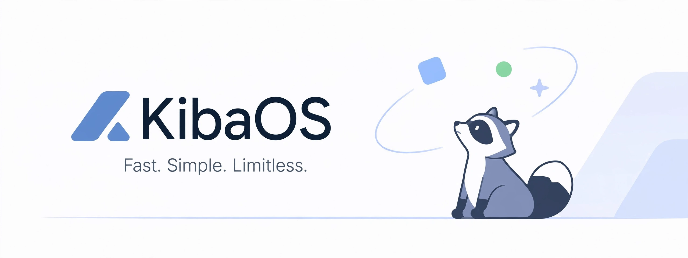

 

  

Description

<!-- Describe what this pull request changes and why. -->

Related issue

<!-- Link related issues. Use closing keywords where appropriate. -->

Closes #

Changes

<!-- Summarize the important changes. -->

Testing

<!-- Explain how these changes were tested. Include relevant commands or test results. -->

* [ ]	Tested locally
* [ ]	Existing tests pass
* [ ]	New tests added or updated, where applicable

Screenshots

<!-- Include screenshots for visual changes. Remove this section if not applicable. -->

Compatibility

* [ ]	No breaking changes
* [ ]	Breaking changes (describe below)
* [ ]	Documentation updated, where applicable

<!-- Describe migration steps or compatibility concerns, if any. -->

Contributor checklist

* [ ]	I have reviewed my own changes.
* [ ]	My changes follow the project’s conventions.
* [ ]	I have updated relevant documentation.
* [ ]	I have not included secrets, credentials, or unrelated files.

Additional context

<!-- Include anything else reviewers should know. -->
