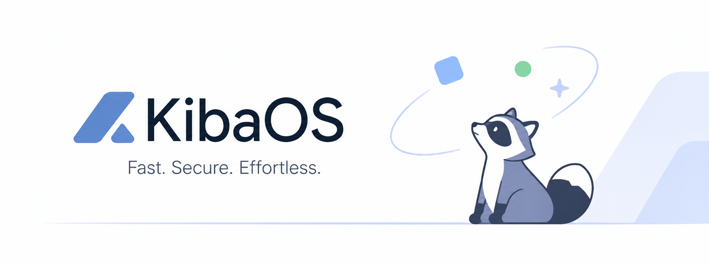

 

  

  <strong>A ready-to-use desktop from Kiba Labs, LLC.</strong>
   
  Simple to install. Simple to use. Built for people switching to simple.

  

  
  

  <a href="https://fluxer.gg/KhLuVJHg">Fluxer</a> ·
  <a href="https://discord.gg/25v2C5mvuv">Discord</a> ·
  <a href="https://matrix.to/#/#kibalabs:matrix.org">Matrix</a>

⸻

  

Meet KibaOS

KibaOS is a modern desktop operating system designed around simplicity, consistency, and a refined user experience.

Built to make everyday computing feel effortless, KibaOS brings together a thoughtfully designed desktop, essential applications, and a cohesive visual identity.

Developed and maintained by Kiba Labs, LLC.

The Desktop

  

A clean, cohesive desktop experience with carefully considered details, intuitive navigation, and a familiar feel.

What’s Included

* KibaDE — A cohesive desktop experience designed around simplicity.
* Everyday applications — Essential tools ready to use out of the box.
* Okami — A graphical application store for discovering and installing software.
* Automatic updates — Keep your system up to date with minimal interruption.
* Custom design — A consistent visual identity throughout the operating system.

System Compatibility

KibaOS currently supports:

* 64-bit x86 computers with UEFI firmware.
* Android devices compatible with TrebleDroid and TWRP running Android 9 for the mobile edition.

Get KibaOS

Ready to try something different?

  

Community

Join the KibaOS community, follow development, and share your feedback.

* GitHub
* Fluxer
* Discord
* Matrix

Support KibaOS

  

License

KibaOS is released under the GNU General Public License v3.0 (GPL-3.0). Individual bundled components may have their own respective licenses.

  <strong>KibaOS</strong>
   
  A Kiba Labs, LLC project.
   
  <a href="https://kibaos.com">Website</a> ·
  <a href="https://sourceforge.net/projects/kibaos/">Downloads</a> ·
  <a href="WIKI.md">Wiki</a>

