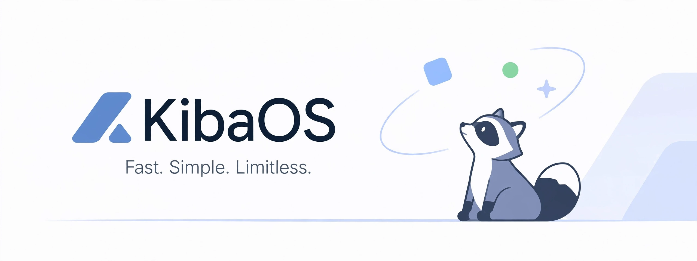
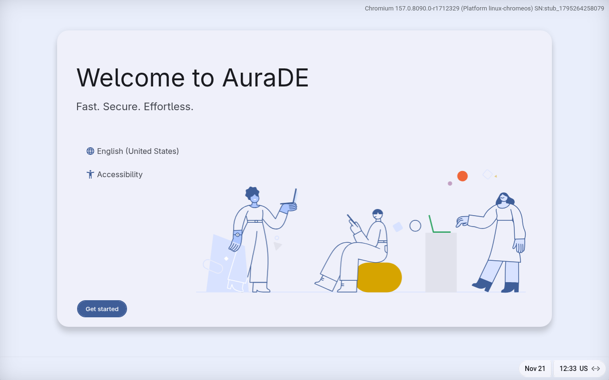

 

  

  <strong>A ready-to-use desktop from Kiba Labs, LLC.</strong>
   
  Simple to install. Simple to use. Built for people switching to simple.

  

  

  <a href="https://fluxer.gg/KhLuVJHg">Fluxer</a> ·
  <a href="https://discord.gg/25v2C5mvuv">Discord</a> ·
  <a href="https://matrix.to/#/#kibalabs:matrix.org">Matrix</a>

Meet KibaOS

KibaOS is a friendly operating system for your computer. It's designed to be simple, consistent, and pleasant to use.

Everyday computing should feel effortless. KibaOS gives you a tidy desktop, the apps you need, and a look that stays the same everywhere.

Developed and maintained by Kiba Labs, LLC.

The Desktop

  

A clean, familiar desktop that's easy to find your way around.

What’s Included

* KibaDE — A simple, easy-to-use desktop.
* Everyday apps — The tools you need, ready to go the moment you turn it on.
* Apps & Games — A store where you can find and install more software with a click.
* Custom design — One look and feel throughout.

System Compatibility

KibaOS works on:

* Most PCs with a 64-bit Intel or AMD processor and UEFI startup.

Get KibaOS

Ready to try something different?

  

Community

Join the KibaOS community, follow development, and share your feedback.

* GitHub
* Fluxer
* Discord
* Matrix

Support KibaOS

  

License

KibaOS is free software, released under the GNU General Public License v3.0 (GPL-3.0). Some included apps have their own licenses.

  <strong>KibaOS</strong>
   
  A Kiba Labs, LLC project.
   
  Built on Arch.
   
  <a href="https://kibaos.com">Website</a> ·
  <a href="https://sourceforge.net/projects/kibaos/">Downloads</a> ·
  <a href="WIKI.md">Wiki</a>

