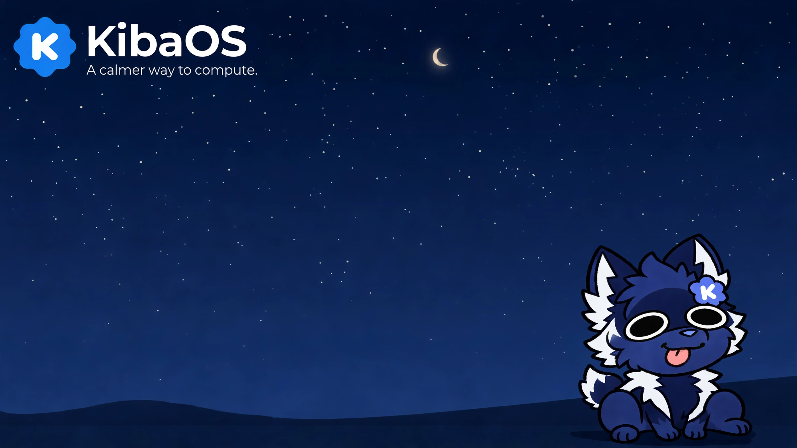

<p align="center">
  
</p>

<div align="center">

# KibaOS
### A ready-to-use Linux desktop from Kiba Labs, LLC

**Simple to install. Simple to use. Built for people switching to simple.**

[](https://sourceforge.net/projects/kibaos/files/latest/download)

[](https://github.com/KibaLabsLLC/Kiba/actions)
[](#license)
[](https://sourceforge.net/projects/kibaos/)

[](https://fluxer.gg/KhLuVJHg)
[](https://discord.gg/25v2C5mvuv)


<p align="center">
  
</p>

</div>

> [!IMPORTANT]
> **Before you download:** KibaOS supports **UEFI-based systems only**. The mobile edition supports Android devices that support TrebleDroid and have TWRP, and requires **Android 9 exactly**. Earlier and later versions are not compatible.

> [!TIP]
> **Meet Kiba, our mascot.** He's a silly raccoon who enjoys blueberries and napping in the sun.

---

<p align="center">
  
</p>

---

## Overview

KibaOS is a complete, ready-to-use desktop operating system. It is built on **Arch Linux** and uses the **Budgie** desktop environment. Arch is a *rolling release*, which means it is continuously kept up to date rather than replaced by large yearly versions.

KibaOS follows one design rule: **nothing should look or feel like it is showing you the plumbing.** The installer, the icons, the terminal and even the boot screen are chosen or built to follow it.

KibaOS is built and maintained by **Kiba Labs, LLC**.

> [!NOTE]
> **New to Linux?** A *distribution* (or *distro*) is a complete, ready-to-install version of Linux, bundled with a desktop, apps and settings. KibaOS is one such distribution. If a term in this document is unfamiliar, we explain it the first time it appears.

## Table of Contents

- [What's Included](#whats-included)
- [Design & Theming](#design--theming)
- [Getting Started](#getting-started)
- [System Requirements](#system-requirements)
- [Everyday Use](#everyday-use)
- [Building KibaOS Yourself](#building-kibaos-yourself)
- [Project Structure](#project-structure)
- [Contributing](#contributing)
- [License](#license)
- [About](#about)

---

## What's Included

KibaOS works well out of the box, so you don't need to spend an afternoon installing software before you can be productive.

| Feature | What it means for you |
| --- | --- |
| **A solid foundation** | Built on Arch Linux, a respected base known for staying current and supporting the newest hardware. |
| **A clean, familiar desktop** | The Budgie desktop provides a top panel, a bottom dock and a clock, laid out so everything is easy to find. |
| **Everyday apps, pre-installed** | File manager (Nemo), web browser, calculator, calendar, email (Geary), notes, music and a to-do list. Each is relabeled with a plain, simple name so the desktop feels like one product. |
| **A simple terminal, when you need it** | The built-in terminal is deliberately minimal: one window, no tabs, no menus. It is there for the rare moment you need it. |
| **`kiba`, a friendly app manager** | Install, remove and update software with plain-language commands instead of memorizing package-manager flags. See [Managing Apps](#managing-apps). |
| **A guided setup experience** | KibaOS's own installer (the *OOBE*, short for "Out-Of-Box Experience") asks you one simple question at a time. |
| **A calm live session** | The trial and install session never dims, locks or sleeps mid-setup, and stays free of raw system dialogs and developer tools. |
| **Automatic background updates** | Small fixes download and apply on their own, without interrupting your work. |

---

## Design & Theming

The look of KibaOS is not an afterthought on top of stock Arch and Budgie. Every visual layer is chosen deliberately so the system reads as one coherent product.

| Layer | What we use | Why |
| --- | --- | --- |
| **Boot splash** | Custom KibaOS Plymouth theme, with an animated Kiba peeking in from the corner | A clean, branded first impression instead of a default boot screen. |
| **App icons** | Cutefish icon theme | A consistent, modern icon set across every app. |
| **Window & UI theme** | Ant-Dark with the Dracula color scheme | A calm dark base that stays easy on the eyes. |
| **Motion** | KibaOS's own "Organic Motion Language" | A shared set of named, natural-feeling animation curves used across the desktop and installer. |
| **App branding** | De-branded where it matters | Apps are relabeled to plain names such as "Browser," "App Store" and "Settings." |

---

## Getting Started

Getting KibaOS running takes four steps. Plan on about 20 to 30 minutes from download to desktop.

| Step | What you'll do | Time |
| :-: | --- | --- |
| **1** | [Download the ISO](#step-1-download-the-iso) | Depends on your connection |
| **2** | [Write it to a USB drive](#step-2-write-it-to-a-usb-drive) | ~5 minutes |
| **3** | [Try the live session](#step-3-try-the-live-session) (optional) | As long as you like |
| **4** | [Install KibaOS](#step-4-install-kibaos) | ~10 to 15 minutes |

### Step 1: Download the ISO

An **ISO file** is a single file that holds an entire disc's worth of data, and is how most Linux systems are distributed. You will write it to a USB drive, then start your computer from that drive.

[](https://sourceforge.net/projects/kibaos/files/)

> [!IMPORTANT]
> Each release includes a **SHA256 checksum**: a short code that verifies your download was not corrupted or tampered with. Checking it is recommended but not required.

### Step 2: Write It to a USB Drive

You will need a USB flash drive of **8 GB or larger**. Everything on it will be erased.

Free graphical tools such as [Balena Etcher](https://etcher.balena.io) or [Ventoy](https://www.ventoy.net) make this easy: select the ISO, select the drive, and click **Flash**.

> [!TIP]
> **On Linux?** You can also use `dd`:
> ```bash
> sudo dd if=kibaos.iso of=/dev/sdX bs=4M status=progress && sync
> ```
> Replace `sdX` with your USB device. Double-check it first, because `dd` will overwrite whatever you point it at.

### Step 3: Try the Live Session

A **live session** runs KibaOS directly from the USB drive without installing anything or changing your computer. It is a good way to confirm that your Wi-Fi, graphics and other hardware work before you commit.

1. Plug in the USB drive.
2. Restart your computer and open the boot menu. This is usually `F12`, `F2`, `Esc` or `Del` right after power-on, and it varies by manufacturer.
3. Choose the USB drive from the list.
4. KibaOS starts and signs you in automatically.

> [!NOTE]
> Nothing you do in the live session is saved after a restart. It exists for trying things out. To keep KibaOS, continue to Step 4.

**Live session sign-in** (only exists on the USB drive, and is replaced by your own account when you install):

| Account | Password |
| --- | --- |
| `liveuser` | `live` |

### Step 4: Install KibaOS

From the live desktop, open **Install KibaOS**. KibaOS's own installer asks you a few questions, one at a time:

1. Your language and region
2. Your keyboard layout
3. Which disk to install onto
4. Your username and password
5. A final confirmation before anything is written to disk

When you confirm, the installer prepares the disk, copies KibaOS onto it, sets up the bootloader and creates your account. When it finishes, restart your computer and remove the USB drive. KibaOS then starts from your own disk.

> [!CAUTION]
> **Installing erases the disk you choose.** Back up anything important first, and make sure you have picked the correct disk if your computer has more than one.

---

## System Requirements

| Component | Minimum | Recommended |
| --- | --- | --- |
| **Firmware** | UEFI | UEFI |
| **CPU** | 64-bit (x86_64) | Dual-core or better |
| **Memory** | 2 GB RAM | 4 GB RAM or more |
| **Storage** | 20 GB free | SSD |
| **Graphics** | OpenGL 2.0 capable GPU | Dedicated graphics card |

---

## Everyday Use

### Getting Around

| To do this | Do this |
| --- | --- |
| **Open apps and search files** | Tap the **Super** key (the Windows or Command key) to open the launcher, then start typing. |
| **Switch between open windows** | Use the dock at the bottom of the screen. Move your mouse to the bottom edge to reveal it. |
| **Manage tasks** | Open **Planify** from the app menu. |

### Managing Apps

KibaOS includes **Okami**, a graphical app store for installing and updating apps from Flathub. Most people will never need the terminal for this.

**Using Okami (graphical)**
- Browse and install apps from Flathub
- Automatic updates for installed apps
- A clean, modern interface

**Using the terminal (optional)**

For people who prefer typing, KibaOS provides short commands on top of the `pacman` package manager:

```bash
update          # Update all packages
install <pkg>   # Install a package
remove <pkg>    # Remove a package
search <term>   # Search for packages
```

### Automatic Updates

KibaOS checks for updates in the background and applies them without interrupting your work. You can also update at any time by running `update` in the terminal or by using Okami.

---

## Building KibaOS Yourself

You can build your own copy of the ISO instead of downloading the prebuilt one. You will need:

- [Docker](https://www.docker.com)
- A Linux computer with at least **15 GB** of free disk space

```bash
git clone https://github.com/KibaLabsLLC/Kiba
cd Kiba
docker run --rm --privileged \
  -v "$PWD:/w" \
  -e RUN_NUM=local \
  archlinux:latest \
  /w/build.sh
```

> [!NOTE]
> `build.sh` runs the entire build: it sets up the Arch Linux base, configures the Budgie desktop, applies KibaOS customizations, builds Okami and packages everything into a bootable ISO. Official releases on SourceForge are built with this same script by GitHub Actions whenever changes are pushed.

---

## Project Structure

```text
Kiba/
├── .github/
│   └── workflows/
│       └── kiba.yml           # When and how GitHub Actions builds KibaOS
├── branding/                  # Logos, banners and brand assets
├── build.sh                   # The full build script and the heart of the project
└── README.md                  # This file
```

---

## Contributing

We welcome contributions. Please read our [Contributing Guide](CONTRIBUTING.md) for how to get started.

Issues and pull requests are welcome at [KibaLabsLLC/Kiba](https://github.com/KibaLabsLLC/Kiba). For larger changes, please open an issue first so we can discuss the approach.

---

## Support the Project

<p align="center">
  <a href="https://github.com/sponsors/KibaLabsLLC">
    
  </a>
</p>

---

## License

KibaOS is a distribution rather than a single piece of software. It bundles many separate projects (the Linux kernel, Budgie, Docker and more), each under its own license. The build scripts and configuration files in this repository are released under the **MIT License**.

---

## About

KibaOS is a project of **Kiba Labs, LLC**.

- [GitHub Organization](https://github.com/KibaLabsLLC)
- [Download on SourceForge](https://sourceforge.net/projects/kibaos/)
- [Wiki](WIKI.md)
