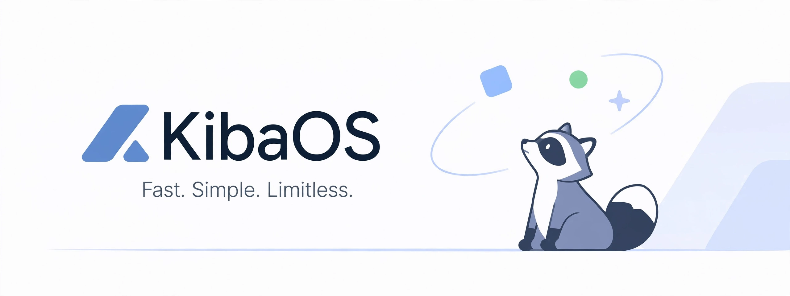

  

# Security Policy

## Supported Versions

KibaOS is currently in active development. We support the latest release on the `main` branch.

## Reporting a Vulnerability

If you discover a security vulnerability within KibaOS, please report it by:

1. **Opening a private security advisory** on GitHub (preferred method)
2. **Contacting Kiba Labs, LLC** directly via the issues tracker for further instructions

We aim to:
- Acknowledge all reports within **48 hours**
- Provide a fix or mitigation plan as soon as possible
- Keep you updated on the progress

## Security Features

KibaOS includes several security measures by default:

- **Privacy-First Browser:** Chromium as default
- **Minimal Attack Surface:** Aggressive bloat removal reduces potential vulnerabilities
- **Secure Defaults:** Passwordless sudo is revoked after installation
